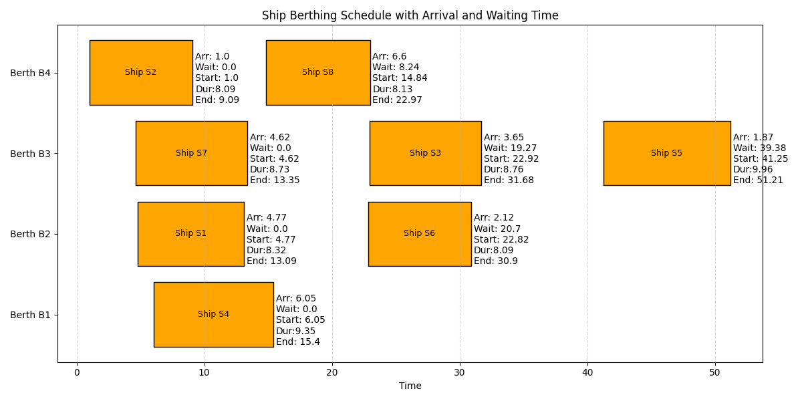
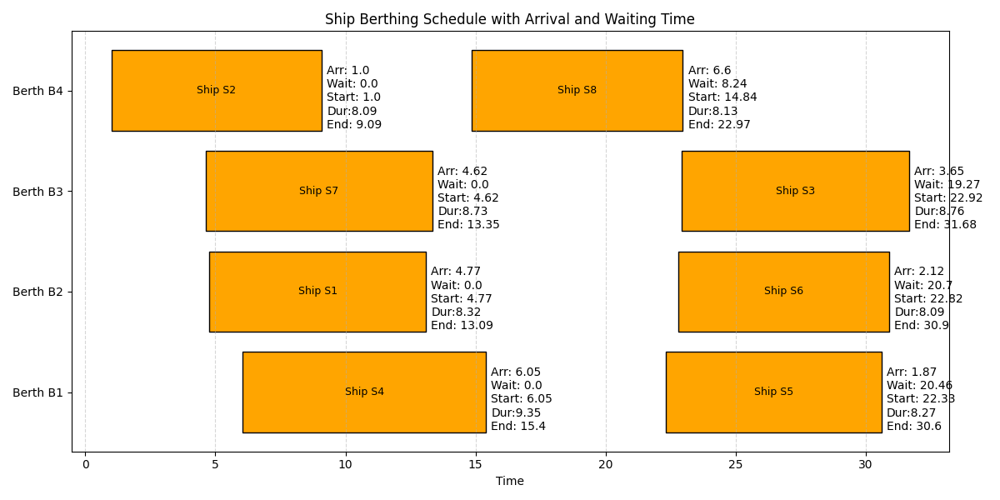

# Ship Berth Allocation and Capacity Planning

### Operations Research II — Optimization Project

<p align="center">
  
  
</p>

<p align="center">
  <b>Mixed-Integer Linear Programming | Pyomo | Gurobi | GLPK</b>
</p>

---

## Overview

This project addresses the **Ship Berth Allocation Problem (BAP)** through a Mixed-Integer Linear Programming (MILP) formulation.

The objective is to determine an optimal allocation and unloading schedule for incoming ships while considering operational constraints, berth capacities, ship dimensions, unloading times, priority relationships, and waiting costs.

In addition to operational scheduling, the model incorporates a berth capacity expansion decision, allowing additional capacity to be acquired when economically beneficial.

The optimization framework simultaneously determines:

- The assignment of ships to available berths.
- The unloading sequence of ships sharing the same berth.
- The optimal unloading start times.
- The required capacity expansion at each berth.

The model minimizes the overall operational cost by balancing capacity investment, ship waiting costs, and unloading expenses.

## Problem Description

The considered port consists of multiple berths serving a collection of incoming ships.

Each ship is characterized by its:
- Arrival time.
- Length.
- Cargo volume.
- Priority level.
- Unloading duration at each berth.

Each berth has its own:
- Available cargo-handling capacity.
- Physical length.
- Maximum number of anchoring positions.
- Setup time (lag) between consecutive ships.
- Capacity expansion limit.
- Capacity expansion cost.

The allocation problem is subject to several operational restrictions. Ships can only be assigned to compatible berths, berth capacities cannot be exceeded without expansion, and ships assigned to the same berth must follow a feasible unloading sequence.

Priority relationships are also incorporated into the sequencing decisions.

## Mathematical Formulation

The problem is formulated as a Mixed-Integer Linear Programming model.

### Decision Variables

The primary decision variables include:

| Variable | Description |
|---|---|
| \(x_{ij}\) | 1 if ship \(i\) is assigned to berth \(j\), 0 otherwise. |
| \(S_i\) | Unloading start time of ship \(i\). |
| \(W_i\) | Waiting time of ship \(i\). |
| \(z_{ikj}\) | 1 if ship \(i\) precedes ship \(k\) at berth \(j\). |
| \(\Delta C_j\) | Additional capacity acquired for berth \(j\). |

Additional continuous and binary variables are introduced to model the piecewise waiting-cost function.

### Objective Function

The objective minimizes the total cost:

\[
\min Z = C_{\text{expansion}}+
C_{\text{waiting}}+
C_{\text{unloading}}
\]

Where:

**1. Capacity Expansion Cost**

\[
C_{\text{expansion}}=
\sum_{j\in B}c_j^{C}\Delta C_j
\]

**2. Ship Waiting Cost**

\[
C_{\text{waiting}}=
\sum_{i\in S}C_i^{W}
\]

Waiting costs are modeled using a piecewise-linear function with three marginal cost segments.

**3. Unloading Cost**

\[
C_{\text{unloading}}=
5\sum_{i\in S}\sum_{j\in B}
x_{ij}t_{ij}
\]

### Main Constraints

The formulation incorporates the following constraints:

| Constraint | Description |
|---|---|
| Ship Assignment | Every ship must be assigned to exactly one berth. |
| Berth Capacity | Total assigned cargo cannot exceed available capacity plus expansion. |
| Capacity Expansion | Capacity expansion is bounded by berth-specific limits. |
| Anchorage Availability | The number of assigned ships cannot exceed the available anchoring positions. |
| Berth Length Compatibility | A ship can only be assigned to a berth with sufficient length. |
| Arrival Restrictions | Unloading cannot begin before a ship arrives. |
| Waiting Time | Waiting time is determined by the difference between unloading start and arrival times. |
| Sequencing | Ships sharing a berth must follow a non-overlapping unloading schedule with the required setup lag. |
| Priority | Precedence relationships between ships are respected. |
| Maximum Waiting Time | Ship waiting times are bounded according to their priority levels. |

## Implementation

The project includes two independent implementations of the optimization model.

### 1. Pyomo Implementation

The primary implementation uses Pyomo's AbstractModel framework.

Features:
- Mathematical formulation separated from input data.
- External parameter loading through `.dat` files.
- MILP model generation.
- LP model export.
- Optimization using GLPK.
- Automated sensitivity analysis.
- Numerical and graphical reporting.

### 2. Gurobi Implementation

A separate implementation is developed using the native Gurobi Python API (`gurobipy`).

This implementation independently constructs the optimization model, including its decision variables, objective function, and constraints.

It provides an alternative optimization environment for solving the same problem.

## Sensitivity Analysis

The project investigates the impact of operational parameter variations on the optimal objective value.

Several scenarios are implemented:

| Scenario | Parameter | Purpose |
|---|---|---|
| 1 | Setup time at Berth B2 | Investigating the effect of berth turnaround time. |
| 2 | Unloading duration of Ship S7 at B3 | Evaluating the impact of unloading efficiency. |
| 3 | Capacity of Berth B2 | Studying the relationship between available capacity and total cost. |
| 4 | Capacity of Berth B3 | Examining the impact of capacity changes at a constrained berth. |
| 5 | Arrival time of Ship S6 | Analyzing the effect of arrival-time variations. |

For each scenario, the optimization model is solved repeatedly under different parameter values.

The resulting objective values are collected and visualized to identify changes in the optimal operational cost.

## Repository Structure

```text
OR2_Project/
│
├── ProjectP2.pdf
│
├── model.py
├── model.ipynb
├── model.lp
│
├── gurobi.py
├── Gurobi_Optimization.ipynb
├── Gurobi_Optimization.pdf
│
├── model_runner.py
├── parameters.dat
│
├── plotter.py
├── textinterface.py
│
├── Figure_1.png
├── Figure_2.png
│
├── ship_berthing_report-a.csv
├── ship_berthing_report-b.csv
└── ship_berthing_report-f.csv
```

### File Descriptions

| File | Description |
|---|---|
| `ProjectP2.pdf` | Original project description. |
| `model.py` | Pyomo mathematical formulation. |
| `model.ipynb` | Jupyter Notebook implementation of the Pyomo model. |
| `parameters.dat` | Input data and model parameters. |
| `model.lp` | Exported linear programming formulation. |
| `gurobi.py` | Native Gurobi implementation. |
| `Gurobi_Optimization.ipynb` | Gurobi optimization notebook. |
| `model_runner.py` | Main execution interface and sensitivity analysis. |
| `plotter.py` | Graphical visualization and sensitivity plots. |
| `textinterface.py` | Tabular reporting and CSV export. |
| `Figure_1.png`, `Figure_2.png` | Project visualizations. |
| `ship_berthing_report-*.csv` | Generated scheduling reports. |

## Installation and Requirements

The Pyomo implementation requires Python and the following packages:

```bash
pip install pyomo matplotlib pandas jupyter
```

Additionally, install the GLPK optimization solver and ensure that its executable is accessible through the system PATH.

For the Gurobi implementation:

```bash
pip install gurobipy
```

A valid Gurobi license is required.

## Running the Project

### Pyomo — Main Optimization

Run the following command from the project directory:

```bash
python model_runner.py -a
```

This executes the main optimization model and generates:
- The optimal ship-to-berth allocation.
- The unloading schedule.
- A tabular scheduling report.
- A graphical representation of the berthing schedule.

### Alternative Scenarios

The execution interface supports several optimization scenarios:

| Argument | Operation |
|---|---|
| `-a` | Solve the original optimization problem. |
| `-b` | Solve the problem without the minimum anchorage constraint at B3. |
| `-c` | Sensitivity analysis on B2 setup time. |
| `-d` | Sensitivity analysis on Ship S7 unloading time at B3. |
| `-e` | Sensitivity analysis on B2 capacity. |
| `-f` | Sensitivity analysis on B3 capacity. |
| `-g` | Sensitivity analysis on Ship S6 arrival time. |

For example:

```bash
python model_runner.py -c
```

### Gurobi

The alternative implementation can be executed using:

```bash
python gurobi.py
```

Alternatively, the corresponding Jupyter Notebook can be used to inspect and execute the optimization model interactively.

## Technologies

- **Python** — Main programming language.
- **Pyomo** — Algebraic mathematical optimization modeling.
- **Gurobi** — Commercial mathematical optimization solver.
- **GLPK** — Open-source linear programming and MILP solver.
- **NumPy / Pandas** — Numerical and tabular data processing.
- **Matplotlib** — Data visualization and sensitivity analysis.
- **Jupyter Notebook** — Interactive model development and experimentation.

## Team

Operations Research II Project

Developed by:

- Aylin Ayati
- Erfan Bidmeshki
- Kayrod Donyadide
- Abbas Ebrahimi

---

<p align="center">
  <b>Operations Research II</b><br>
  Mathematical Optimization • Scheduling • Decision Science
</p>
